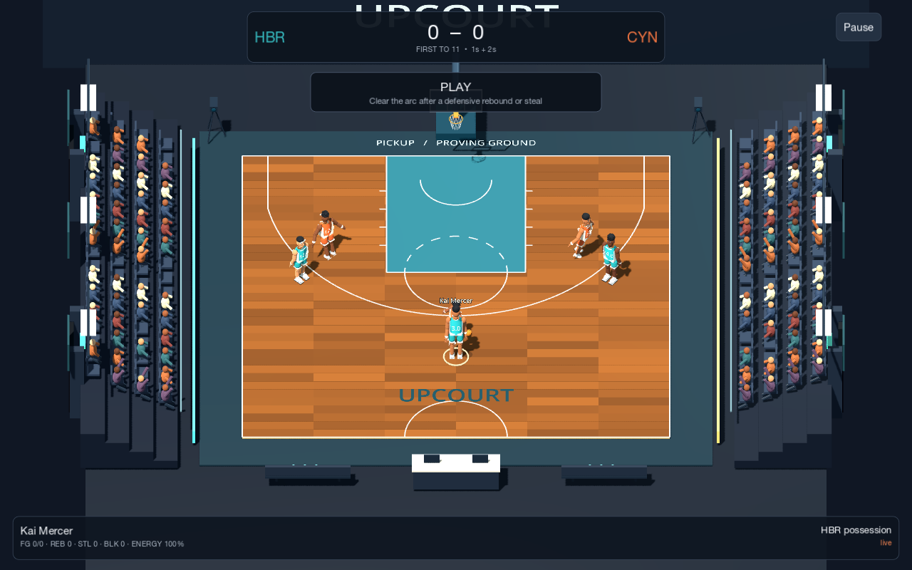
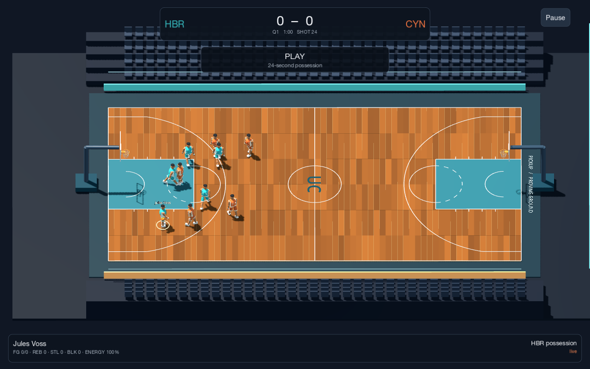

# Upcourt

A playable 3D basketball prototype built with Godot 4 and GDScript. Choose fictional teams, create space, and time your release in half-court pickup or full-court exhibition. Opens directly to **Play Now**.





## Version 0.2.1

Opponent steals and opponent pass interceptions are disabled in both modes. The human-controlled team can steal and intercept. CPU defense still contests shots, blocks, and rebounds.

### Visual and handling upgrades from 0.2.0

Added articulated knees, ankles, wrists, elbows, torso counter-rotation, head motion, defensive crouches, shooting follow-through, and passing poses. Player heights affect visual proportions. Models have shaped jerseys, facial features, hairstyle variation, fingers, shoe soles, and laces. Arena additions include spectators, tunnels, lighting structures, courtside benches, scorer monitors, bottles, and broadcast cameras.

Ball handling now has three animated hand-switching paths. Press F/B for a crossover, C/right bumper for between the legs, or V/right-stick click for behind the back. Each move uses six stamina points and has a short cooldown. Higher handling ratings produce faster moves. Keep moving with the directional controls to create separation.

[Download the latest Mac game and Godot project](https://github.com/ryanlin214214-maker/upcourt/releases/latest)

## Launch

- **Mac app** — Extract `Upcourt-v0.2.1-macOS.zip` and open `Upcourt.app`. The universal build supports Apple Silicon and Intel. It is ad-hoc signed for local use and has no Apple notarization. macOS may require approval through Privacy & Security on another Mac.
- **Source** — Download and extract `Upcourt-Godot-Project.zip` from this repository or the versioned project ZIP from Releases. Import `project.godot` in Godot 4.7.2 and press F6 on `scenes/main.tscn`, or F5 to run the project. The Compatibility renderer is selected. No third-party addons are required.
- **Export** — Install Godot 4.7.2 export templates in the editor, then use the included `macOS` export preset.

## Controls

Controller labels follow the Xbox layout. PlayStation Square corresponds to X here. The Controls screen is available from Play Now and Pause.

| Action | Keyboard | Controller |
| --- | --- | --- |
| Move relative to camera | WASD / arrows | Left stick |
| Sprint | Shift | Right trigger |
| Begin and release a shot | Hold / release Space | Hold / release X |
| Pass / request pass / steal | E | A |
| Switch controlled player | Q | Left bumper |
| Jump to block / rebound | R | Y |
| Crossover / switch hand | F | B |
| Between the legs | C | Right bumper |
| Behind the back | V | Right stick click |
| Pause / resume | Escape | Start |

Aim a pass with your movement direction. Without a direction, the game favors an open teammate. If you control an off-ball teammate, Pass requests the ball. A selection ring identifies your player. Passing transfers control to the receiver.

Release in the green meter zone. Shooting and finishing ratings affect both the size of that zone and make probability. Distance, release error, defensive proximity, a defender's jump, and defensive ratings all affect the shot. Close attempts use finishing ratings and a separate layup model. An excellent release can still miss, especially under pressure.

## Modes and completed features

**Half-court pickup** has six players, AI teammates and opponents, 1s inside the arc and 2s outside, first to 11, and a 20-second possession clock. Defensive rebounds, steals, and interceptions require clearing beyond the arc before a shot. Offensive rebounds retain clearance. Made baskets and out-of-bounds plays restart with the opposing team. Ties have no special rule because the target-score game ends as soon as a team reaches 11.

**Full-court exhibition** has ten players, four selectable 1- or 2-minute quarters, 2s and 3s, a 24-second shot clock, automatic inbound passes after stoppages, transition offense and defense, halftime direction changes, and one-minute overtime periods until the tie is resolved. Offensive rebounds reset to 14 seconds. Pause to substitute a bench player for your currently selected home-team player. The score and game clock freeze while paused.

Both modes include acceleration, sprint stamina, dribbling, crossovers, intended-receiver passing, pass interceptions, switching, timed jump shots and layups, blocks, loose balls and rebounds, score feedback, pause, and rematch. AI uses the shared movement, passing, and shooting methods, with opponent steals disabled. Teammates space and cut, defenders track assignments and close out. Difficulty changes CPU release precision, while ratings remain the basis of the shot calculation.

Four fictional teams each have six players. **Rosters / Create player** edits names, numbers, heights, and seven ratings or adds a player to the bench. Changes persist locally. Newly created bench players can enter through substitutions.

## Roster format and authorized assets

`data/rosters.json` contains a `schema_version` and `teams` array. Each team has a unique `id`, `city`, `name`, `abbr`, hexadecimal `color` and `trim`, optional `logo_path`, and a `players` array. Each player has a unique team-local `id`, `name`, jersey `number`, `height` in metres, optional `model_path`, and nested `ratings` for `speed`, `shooting`, `finishing`, `defense`, `passing`, `handling`, and `rebounding`.

Ratings range from 25 to 99. Teams need at least six players. Names and colors are consumed directly by the game. `logo_path` and `model_path` are reserved extension fields for local authorized assets under `res://assets/` or `user://assets/`; the current renderer uses procedural jerseys and players, so custom logo/model rendering requires wiring those fields into the renderer.

Edits save atomically to `user://rosters.json`, which overrides the bundled defaults. On macOS this project uses `~/Library/Application Support/Upcourt/`. Move the local roster file aside to restore bundled defaults. Malformed local rosters fall back to bundled data.

## Verification

Tested with Godot 4.7.2 on Apple Silicon macOS using native OpenGL rendering and headless simulation. The native scene, menu, half court, full court, and roster editor were launched and visually inspected.

The included integration suite passed 72 checks covering movement, sprint stamina, dribble attachment, shot timing/rating/distance/contest effects, layups, intended passing, one-time basket counting, possession changes, blocks, rebounds, clearing, out-of-bounds, rematch, inbounding, shot-clock expiry, quarter transitions, pause/resume, substitutions, disabled opponent steals/interceptions, retained human-team steals, and simulated controller shot events.

The same production simulation completed an automated 3-on-3 match, 11–9 after approximately 656 simulated seconds, and a four-quarter 5-on-5 match, 12–6. These are automated matches, not a claim of a human playthrough. Local roster persistence and validation were checked separately.

Run the regression suite from this project directory with a Godot executable on your PATH.

```sh
godot  --headless --path . --script res://tests/match_checks.gd
```

## Known limitations

- Prototype visuals use articulated geometric players and procedural courts. Ball handling and rebounds use controlled trajectories and custom contact rules. Animation and collision detail remain simplified.
- Controller mappings and simulated input events were tested. Physical gamepad feel, vibration, and device-specific mappings remain unverified.
- Full-court inbounding is automatic. Substitutions are manual for the human team. Fouls, free throws, detailed violations, season play, and career progression are outside this prototype.
- Matches are local single-player versus AI. Roster edits persist, while match scores and progress reset when the application closes.
- The macOS build was tested on Apple Silicon. Intel runtime performance remains unverified.

Original code, procedural player/court art, fictional roster, and generated WAV effects are included. Godot is distributed under the MIT license. Engine information and licenses are available at https://godotengine.org/license/.
